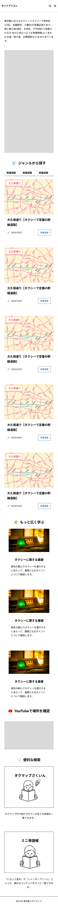
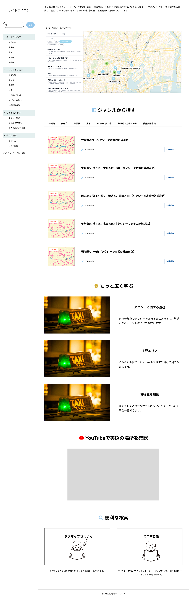

# UI・UX設計

## 基本方針

運行中に対象の情報へ素早くアクセスできることを目指す。ピンマップ、検索結果、記事ページ全体に同じUX原則を適用する。

記事ページでは、「車寄せの情報」や「特定方向での右折禁止」など運行中に必要となる可能性が高い情報と、ビジュアルで確認できるYouTubeを優先的に上部へ配置する。

カテゴリごとに優先情報は異なる。例えば「施設」では車寄せ、「交差点」や「首都高」では右折禁止の情報を重視する。これらの「そのページで強調すべき情報を表示したブロック」を「重要ブロック」と呼ぶ。

実践講座、さくいん、ミニ単語帳は教科書や辞書のような位置づけとし、休憩中などの閲覧を想定する。

## 検索UI

### モバイル

トップページにはピンマップを配置し、固定ヘッダーには検索ボタンとハンバーガーメニューを配置する。検索ボタンを独立させ、「すぐに検索できる」ことを示す。固定ヘッダーに置くことで、どのページからでも検索できるようにする。

検索ボタンを押すと、検索ボックスとサジェストに広い領域を使う共通モーダルを開く。文字や候補が狭くなるため、インライン入力欄は採用しない。

参考: 

### PC

PCでも検索ボタンをヘッダーに常設する。広い画面ではピンマップの利用も多いと考え、モバイルのような「第一導線: 検索、第二導線: ピンマップ」という優先順位を強く意識しない。

検索モーダルは、すべての画面から共通のものを開く。

## ピンマップ

トップページのファーストビューに常設する。PC、タブレット、スマートフォンではレイアウトのみを変更し、表示コンテンツは変えない。

参考: 

参考: 

### ピンの表示

色だけでカテゴリを区別させない。ピンの中に1文字のラベルを入れ、文字でも区別できるようにする。色の見え方の多様性に加え、運行中にスマートフォンの小さな画面で見る場面があるため。

色はOkabe-Ito（岡部・伊藤）の配色から選ぶ。色覚のタイプが違っても互いに見分けやすいよう、明るさにも差を付けた配色である。

| カテゴリ           | 色                    | ラベル | 理由                                                                                |
| ------------------ | --------------------- | ------ | ----------------------------------------------------------------------------------- |
| 首都高             | `#009E73`（青みの緑） | 首     | 首都高の案内標識が緑で、運転手の感覚と合わせやすい                                  |
| 主要駅             | `#0072B2`（濃い青）   | 駅     | 濃くはっきりした色で、目印になる駅を目立たせる                                      |
| 施設               | `#E69F00`（オレンジ） | 施     | 淡色地図の上でも埋もれない。純粋な黄色は白っぽい地図の上で見えにくいため避ける      |
| 交差点             | `#D55E00`（朱色）     | 交     | 信号や「注意」を連想させる赤系                                                      |
| 抜け道・定番ルート | `#56B4E9`（空色）     | 抜     | 参考にしたsample-mapの水色に近い                                                    |
| 通称がある道       | `#CC79A7`（赤紫）     | 通     | 残りの色の中で、ほかの5色と最も見分けやすい                                         |
| 上記以外           | `#7F7F7F`（灰色）     | 幹、基、エ、他 | 掲載の目安から外れるカテゴリ。もし `pinmap: true` でも「想定外のピン」と分かる |

「上記以外」は幹線道路（幹）、タクシー基礎（基）、主要エリア解説（エ）、その他お役立ち知識（他）。

オレンジ（施設）と朱色（交差点）は比較的近い組み合わせのため、文字のラベルが区別の決め手になる。

ラベルは黒の太字にする。白い文字だとオレンジと空色の上でコントラスト比が約2.3:1しかないが、黒なら7色すべてで約4:1以上になる（最も低いのは濃い青で約4.0:1）。

ピンマップ以外の配色も、色だけに頼らない方針で詰める。参考: [東京都カラーユニバーサルデザインガイドライン](https://www.fukushi.metro.tokyo.lg.jp/documents/d/fukushi/colorudguideline2)

### カテゴリの絞り込み

地図の上に、「すべて」と、掲載の目安の6カテゴリ（交差点、主要駅、施設、抜け道・定番ルート、通称がある道、首都高）のボタンを並べる。1つ選ぶと、そのカテゴリのピンだけを表示する。「首都高の入口を確かめたい」場面などで、探す範囲を一気に絞れる。

- 各ボタンには、ピンと同じ色の丸と1文字を付け、凡例を兼ねる
- 選んでいるボタンは、色ではなく太字・下線で示す。読み上げソフト向けに `aria-pressed` も付ける

### クラスタリング

近くのピンを、数字入りの丸にまとめる。ピンは現在200〜270本、600本時に400〜500本の見込みで、港区に偏る。都心全体が見える縮尺ではピンが重なり、スマートフォンでは狙ったピンを押せなくなるため。

まとめた丸にはカテゴリの色と文字が出ないので、運行中に見る縮尺（ズーム16）以上ではまとめない。ピンを押す段階では、必ず色と文字のピンが見える。

### 一覧表示（サイドバー）

現時点では設けない。全件の一覧は名前で探す使い方になり、第一導線の検索と役割が重なるため。また、PC・タブレット・スマートフォンで表示内容を変えない方針から、PCのサイドバーと同じ内容をスマートフォンでも出す必要がある。

本実装のデザインの段階で、レイアウトと一緒に考える。候補は「画面に見えている範囲のピンだけの一覧」（地図で寄せた後に、名前で選べる）。参考: [参考資料](../references.md#ピンマップ地図アプリ) のNaimap、SeichiMap

## 記事ページ

記事ページは次の順序で構成する。

1. 重要ブロック（運行中に読まれる）
2. 「このページをQRコードで共有する」ボタン（運行中に使用される）
3. 本文（主に休憩時など時間のあるときに読まれる）

共有機能は有用だが、QRコードでWebページを共有する行動は一般的ではないため、重要ブロックより表示優先度を下げる。

## ブランドのトーン

教科書的なイメージとする。「緊張感のある実際の運行時の使用」を見据え、オシャレさよりストレスの少ない操作を重視する。

現在のプライマリーカラーは、目に優しく落ち着いた `#95C7EC`。一方で、「安全」「自然」を想起させる緑色も候補として検討中である。

## レスポンシブ対応

モバイルファースト、レスポンシブデザインで設計する。車内での利用を基本とする。

既存サイトのデバイス別使用率（Googleアナリティクス、2026/06/24時点、1か月単位）は次のとおり。

- モバイル: 64.9%
- デスクトップ: 33.8%
- タブレット: 1.4%

対象デバイスはPC、タブレット（TB）、スマートフォン（SP）。タブレットは利用率が低いものの、個人所有の端末を運転席に設置するドライバーもいるため対象とする。それぞれに固有のブレイクポイントを設ける。

## サイドバー

初期状態ではサブメニューを閉じ、スクロール時は固定する。

## ビジュアル

### ロゴ・サイトアイコン

方向性は未定。

### 記事サムネイル

各記事に用意されている「記事の概要を1枚にまとめた画像」を使用する。
