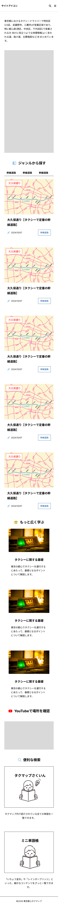
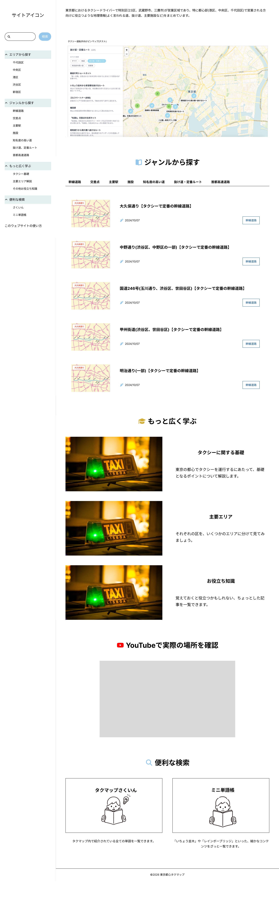

# UI・UX設計

## 基本方針

運行中に対象の情報へ素早くアクセスできることを目指す。ピンマップ、検索結果、記事ページ全体に同じUX原則を適用する。

記事ページでは、「車寄せの情報」や「特定方向での右折禁止」など運行中に必要となる可能性が高い情報と、ビジュアルで確認できるYouTubeを優先的に上部へ配置する。

カテゴリごとに優先情報は異なる。例えば「施設」では車寄せ、「交差点」や「首都高」では右折禁止の情報を重視する。これらの「そのページで強調すべき情報を表示したブロック」を「重要ブロック」と呼ぶ。

実践講座、さくいん、ミニ単語帳は教科書や辞書のような位置づけとし、休憩中などの閲覧を想定する。

## デザイン資料と実装

**方針の正はこのドキュメント（および関連するdocs）**とする。Figmaや書き出し画像よりあとにdocsで決めた内容（例: ピンマップをファーストビューに常設、検索導線）を優先する。

材料の役割:

| 材料 | 役割 |
| --- | --- |
| docs（本ファイル、機能要件など） | 方針・優先度の正 |
| Figma | 雰囲気・ナビ構成・色などの参考。ピンマップはプレースホルダー／試作の置き場だった時期がある |
| `logs/ai/images/all/20260619/` などの書き出し | 当時の参考メモ（生きている正ではない） |
| [sample-map](https://github.com/sakurai0808/sample-map) とPoCのピンマップ | 地図UIの動く土台。見た目の細部は本実装で詰める |

役割の分け方（学習方針）:

- **開発者**: 手で実装する（学習が主眼。AIに完成形のコードを書かせない）
- **AI**: 仕様・文法の説明と、大きなズレのチェック。公式Figma MCPは読み取り・照合の参考に使い、実装コードの生成・貼り付けには使わない

「大きなズレ」とみなすもの（照合の第一はdocs。Figmaは補助）:

1. **構成** — ブロックの有無と上下の順
2. **レイアウトの骨格** — カラム構成、ファーストビューの内容、PC／TB／SPの切り替えの考え方
3. **見た目のトーン** — 色・余白の「だいたい」、フォントの系統

数pxの差、影の濃さ、角丸のぴたり一致などの**細部は原則スルー**する（開発者が「ここは合わせて」と言ったときだけ見る）。ピクセルパーフェクトを追って公開が見えなくなる事態を避ける。

例: FigmaのPCトップは左サイドバー中心だが、本ファイルは固定ヘッダーに検索を置く。実装は本ファイルに従い、サイドバー一式の再現を必須としない。

## 検索UI

### モバイル

トップページにはピンマップを配置し、固定ヘッダーには検索ボタンとハンバーガーメニューを配置する。検索ボタンを独立させ、「すぐに検索できる」ことを示す。固定ヘッダーに置くことで、どのページからでも検索できるようにする。

検索ボタンを押すと、検索ボックスとサジェストに広い領域を使う共通モーダルを開く。文字や候補が狭くなるため、インライン入力欄は採用しない。

閉じ方は次のとおり（2026-11-16決定・PoC実装済み）。閉じるボタン、背景（幕）のクリック、Esc、検索送信後。候補のタップは入力欄にタイトルを入れるだけで、モーダルは閉じない（結果一覧へは検索ボタンかEnter）。

参考: 

### PC

PCでも検索ボタンをヘッダーに常設する。広い画面ではピンマップの利用も多いと考え、モバイルのような「第一導線: 検索、第二導線: ピンマップ」という優先順位を強く意識しない。

検索モーダルは、すべての画面から共通のものを開く。実装メモ（z-index・ダーク時の文字色など）は [アーキテクチャの共通ヘッダー・検索モーダル](../engineering/architecture.md#共通ヘッダー検索モーダル) を参照。

## ピンマップ

トップページのファーストビューに常設する。PC、タブレット、スマートフォンではレイアウトのみを変更し、表示コンテンツは変えない。

参考: 

参考: 

### ピンの表示

色だけでカテゴリを区別させない。ピンには**カテゴリごとのアイコン（形）**を入れ、色と形の両方で区別する。色の見え方の多様性に加え、運行中にスマートフォンの小さな画面で見る場面があるため。

1文字の漢字ラベル（施・抜など）は、意味は分かりやすい一方で堅い印象が強く出やすい。仕事明けで疲れているドライバーにも、少し遊び心のある見た目にしたいため、アイコンを本線とする（2026-11-15決定）。

色はOkabe-Ito（岡部・伊藤）の配色から選ぶ。色覚のタイプが違っても互いに見分けやすいよう、明るさにも差を付けた配色である。

| カテゴリ           | 色                    | アイコン（当面） | 理由・メモ |
| ------------------ | --------------------- | ---------------- | ---------- |
| 首都高             | `#009E73`（青みの緑） | `faTruckFast`（sample-map） | 案内標識が緑。アイコンはsample-mapに合わせる |
| 主要駅             | `#0072B2`（濃い青）   | `faTrainSubway` | 濃くはっきりした色。シルエットが道系と被りにくい |
| 施設               | `#E69F00`（オレンジ） | `faHouse`（sample-map） | 淡色地図でも埋もれにくい。純粋な黄色は避ける |
| 交差点             | `#D55E00`（朱色）     | `faTrafficLight` | 信号や「注意」を連想。オレンジと色が近いので形の差が特に大事 |
| 抜け道・定番ルート | `#56B4E9`（空色）     | `faRoute`（sample-map） | sample-mapの水色に近い |
| 通称がある道       | `#CC79A7`（赤紫）     | `faRoad`（sample-map） | 他色と見分けやすい |
| 上記以外           | `#7F7F7F`（灰色）     | `faLocationDot` など汎用 | 掲載の目安外。`pinmap: true` でも想定外と分かる |

「上記以外」は幹線道路、タクシー基礎、主要エリア解説、その他お役立ち知識。

実装の道具:

- 当面は [sample-map](https://github.com/sakurai0808/sample-map) と同じ **Font Awesome（`@fortawesome/react-fontawesome` など）** を使ってよい
- Illustratorで自前SVGを描く案もあるが、優先度は低い（本実装の後半以降で検討）

ピン上のアイコンは、背景色の上でコントラストが取れる色（白または黒）にする。読み上げ向けにはカテゴリ名を `aria-label` などで補う。

ピンマップ以外の配色も、色だけに頼らない方針で詰める。参考: [東京都カラーユニバーサルデザインガイドライン](https://www.fukushi.metro.tokyo.lg.jp/documents/d/fukushi/colorudguideline2)

### カテゴリの絞り込み

地図の上に、「すべて」と、掲載の目安の6カテゴリ（交差点、主要駅、施設、抜け道・定番ルート、通称がある道、首都高）のボタンを並べる。1つ選ぶと、そのカテゴリのピンだけを表示する。「首都高の入口を確かめたい」場面などで、探す範囲を一気に絞れる。

- 各ボタンには、ピンと同じ色の丸と**同じアイコン**、および**カテゴリ名の文字**を付け、凡例を兼ねる（アイコンだけにしない）
- 選んでいるボタンは、色ではなく太字・下線で示す。読み上げソフト向けに `aria-pressed` も付ける

### クラスタリング

近くのピンを、数字入りの丸にまとめる。ピンは現在200〜270本、600本時に400〜500本の見込みで、港区に偏る。都心全体が見える縮尺ではピンが重なり、スマートフォンでは狙ったピンを押せなくなるため。

まとめた丸にはカテゴリの色とアイコンが出ないので、運行中に見る縮尺（ズーム16）以上ではまとめない。ピンを押す段階では、必ず色とアイコンのピンが見える。

### ポップアップ

上からタイトル、概要（`summary`）、解説記事へのボタン、Googleマップへのボタン。余白を取り、リンクはピル型ボタンにする（参考: [ShiobaLove](../references.md#ピンマップ地図アプリ) の見やすさ。画像付きレイアウトは借りない）。

**画像は出さない。** `thumbnail` は地図イラストであり、小さいポップアップでは邪魔になる。将来、施設カテゴリだけ実写を載せる案はあるが、いまは不要（2026-11-15）。

### 一覧表示（サイドバー）

現時点では設けない。全件の一覧は名前で探す使い方になり、第一導線の検索と役割が重なるため。また、PC・タブレット・スマートフォンで表示内容を変えない方針から、PCのサイドバーと同じ内容をスマートフォンでも出す必要がある。

本実装のデザインの段階で、レイアウトと一緒に考える。候補は「画面に見えている範囲のピンだけの一覧」（地図で寄せた後に、名前で選べる）。参考: [参考資料](../references.md#ピンマップ地図アプリ) のNaimap、SeichiMap

## 記事ページ

記事ページは次の順序で構成する。

1. 重要ブロック（運行中に読まれる）
2. 「このページをQRコードで共有する」ボタン（運行中に使用される）
3. 本文（主に休憩時など時間のあるときに読まれる）

共有機能は有用だが、QRコードでWebページを共有する行動は一般的ではないため、重要ブロックより表示優先度を下げる。QRコードの共有ボタンは最初の公開には含めない（[機能要件](../requirements/features.md#最初の公開の範囲)）。

## ブランドのトーン

教科書的なイメージとする。「緊張感のある実際の運行時の使用」を見据え、オシャレさよりストレスの少ない操作を重視する。

現在のプライマリーカラーは、目に優しく落ち着いた `#95C7EC`。一方で、「安全」「自然」を想起させる緑色も候補として検討中である。

## レスポンシブ対応

モバイルファースト、レスポンシブデザインで設計する。車内での利用を基本とする。

既存サイトのデバイス別使用率（Googleアナリティクス、2026/06/24時点、1か月単位）は次のとおり。

- モバイル: 64.9%
- デスクトップ: 33.8%
- タブレット: 1.4%

対象デバイスはPC、タブレット（TB）、スマートフォン（SP）。タブレットは利用率が低いものの、個人所有の端末を運転席に設置するドライバーもいるため対象とする。それぞれに固有のブレイクポイントを設ける。

## サイドバー

初期状態ではサブメニューを閉じ、スクロール時は固定する。

## ビジュアル

### ロゴ・サイトアイコン

方向性は未定。

### 記事サムネイル

各記事に用意されている「記事の概要を1枚にまとめた画像」を使用する。
